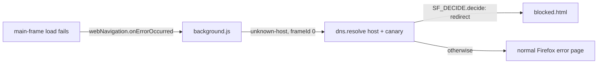

# Agent guide (maintainers & AI assistants)

This document orients anyone (including automated coding agents) who opens this repository so work can continue without rediscovering context.

## Purpose

**Something Fishy** is a personal, **Firefox-only** Manifest V3 Web Extension. When a top-level page fails to load **because the DNS resolver blocked it** (the owner's Pi-hole, which also passes through Cloudflare for Families blocks), it replaces Firefox's generic error page with a message page the owner writes ("encouraging discouragement"), optionally per site and per time of day, with a local count of attempts.

It is a **message layer, not the lock.** Pi-hole does the blocking; this extension only decorates the failure. It never offers a way past the block.

Human-facing overview: [README.md](README.md).

## Status

Feature-complete v0.1. **Re-test passed on the owner's PC (2026-10-22)** after the intermittent-skip fix; the offline case is still unobserved. Signing (`npm run sign`) is set up but not yet run; the gecko id and name must be confirmed with the owner first (they're permanent on AMO).

## How it decides "blocked by my DNS"

### What the network says vs. what Firefox sees

On the wire, Pi-hole answers a blocked name with `0.0.0.0` / `::`, and Cloudflare for Families blocks (forwarded by Pi-hole) look the same; a non-existent name gets NXDOMAIN. Verified on the owner's PC with `nslookup` and `Resolve-DnsName` (2026-10-21).

**But Firefox on Windows can't see that difference.** Windows' resolver (`getaddrinfo`, what Firefox's native resolver calls) drops the null records: for a blocked name it fails with *"The requested name is valid, but no data of the requested type was found"* (WSANO_DATA); for a non-existent name with *"No such host is known"* (WSAHOST_NOT_FOUND). Firefox collapses both into `NS_ERROR_UNKNOWN_HOST`, for the page load and for `browser.dns.resolve()` alike (with or without `bypass_cache`). Firefox's own resolver code (`netwerk/dns/`) doesn't filter null addresses — the loss is in Windows. No pref or API exposes the WSA error to extensions.

### The rule (agreed with the owner, 2026-10-22)

**Treat "unknown host" on a top-level page as blocked, as long as DNS otherwise works.** The owner rarely types URLs, so typos are rare; the message page says "almost always a block, occasionally a typo" and shows the hostname. This *relaxes* the original requirement that typos must never trigger it — deliberately.

| Observation | Action |
|---|---|
| Main frame, error `NS_ERROR_UNKNOWN_HOST`, `dns.resolve` also says unknown host, canary (`example.com`) resolves, `navigator.onLine` | **Show the message page** |
| `dns.resolve` returns only `0.0.0.0` / `::` (resolvers that pass them through, i.e. not Windows) | **Show the message page** |
| Error is `NS_BINDING_ABORTED` or anything other than unknown host | Nothing |
| Host resolves to real addresses (site down, refused, TLS…) | Nothing |
| Canary fails, or `navigator.onLine` is false (offline / Pi-hole down) | Nothing |
| Subframe (`frameId !== 0`), non-http(s), IP literal, `localhost` | Nothing |

The canary means a dead Pi-hole doesn't paint every site as "blocked". Pi-hole must keep its default blocking mode for the *non-Windows* path; on Windows any blocking mode ends up as unknown host.

Rejected alternatives (see the owner discussion): asking a public DoH resolver whether the name exists (sends failed hostnames to Cloudflare, extra request); asking the Pi-hole v6 API (needs an app password + a LAN host permission). Either could be added later as an opt-in refinement — see Roadmap.

## Repository map

| Path | Role |
|------|------|
| [manifest.json](manifest.json) | MV3, Firefox-only: `background.scripts` event page, `options_ui`, permissions `dns, webNavigation, storage`, no `host_permissions`. |
| [src/background/background.js](src/background/background.js) | Listens to `webNavigation.onErrorOccurred` (and `onBeforeNavigate` to know when a tab moved on), runs the lookups, asks `SF_DECIDE`, counts the attempt, redirects with `loadReplace`. Records `isTRR` sightings and, if enabled, a decision log. |
| [src/blocked/blocked.html](src/blocked/blocked.html) / [.js](src/blocked/blocked.js) / [.css](src/blocked/blocked.css) | The message page: reads `?url=` and the entry the background picked (`&r=<rule>&e=<entry>`; options preview uses `&preview=1&title=&text=`), renders it with the attempt count, **Go back** / **Close tab**, link to settings. No bypass. |
| [src/blank/blank.html](src/blank/blank.html) / [.js](src/blank/blank.js) | Shipped "blank page" destination; only sets the tab title. |
| [src/options/options.html](src/options/options.html) / [.js](src/options/options.js) / [.css](src/options/options.css) | Settings: default title/messages, per-site rules (reorder, enable, time windows, preview), attempt table with reset, DoH warning, opt-in troubleshooting log. Refuses to save invalid input rather than dropping it. |
| [src/common/decide.js](src/common/decide.js) | `SF_DECIDE.classifyError / shouldInvestigate / decide` — the redirect decision, pure. |
| [src/common/address.js](src/common/address.js) | `SF_ADDRESS.isNullAddress / isBlockedAnswer` — `0.0.0.0` / `::` (any spelling). |
| [src/common/url.js](src/common/url.js) | `SF_URL.candidateHost(url)` — hostname to check, or `null` for URLs to ignore. |
| [src/common/config.js](src/common/config.js) | Storage keys, `DEFAULT_CONFIG` (placeholder wording), `normalizeConfig`, validation helpers. |
| [src/common/rules.js](src/common/rules.js) | `SF_RULES` — pattern matching, first-match rules, time windows, random `chooseEntry` / `pickEntry`, `renderTemplate` (text), `renderUrl` (page addresses). |
| [src/common/attempts.js](src/common/attempts.js) | `SF_ATTEMPTS.recordAttempt` — per-host counter, capped at 500 hosts. |
| [src/common/page.css](src/common/page.css) | Shared colours (light/dark) for the two pages. |
| [tests/](tests/) | `node:test` unit tests for everything in `src/common/` (no browser). |
| [tools/diagnostic/](tools/diagnostic/) | Throwaway logging-only extension used to establish the findings above. Not shipped; keep for re-checking after Firefox/Windows updates. |
| [scripts/sign.local.example.ps1](scripts/sign.local.example.ps1) | Template for the git-ignored signing script holding AMO keys. |
| [web-ext-config.cjs](web-ext-config.cjs) | Keeps dev files out of the package; DoH off in `web-ext run` profiles. |
| [icons/](icons/) | Regenerate with `py scripts\generate-icons.py` (Windows) / `python3 scripts/generate-icons.py` — stdlib-only PNG writer adapted from address-quick-display's. |

## Architecture (runtime)

1. `webNavigation.onErrorOccurred` with an `http`/`https` scheme filter (Firefox throws on an empty filter). `SF_DECIDE.shouldInvestigate`: `frameId === 0` and error is unknown host (or missing).
2. `SF_URL.candidateHost(url)`; skip `null`. A per-`tabId|url` in-flight set prevents double handling.
3. In parallel: `dns.resolve(host)` and `dns.resolve("example.com", ["bypass_cache"])`. Either `isTRR` → store `sfDohSeen`.
4. `SF_DECIDE.decide({ host, canary, online: navigator.onLine })`.
5. If redirecting: skip if `onBeforeNavigate` saw a newer top-level navigation in that tab to a different URL (the user moved on). This deliberately does **not** compare `tab.url`: in the first test pass the redirect was intermittently skipped, most likely because `tab.url` hadn't switched to the failed URL yet when checked. Then increment `sfAttempts[host]`; `tabs.update(tabId, { url: blocked.html?url=…, loadReplace: true })`. `loadReplace` replaces the failed history entry, so **Back** goes to the previous page rather than re-triggering.
6. Pick what to show: `SF_RULES.pickEntry` (random among fitting entries, see schema). Then by `show`: **message** → `blocked.html?url=…&r=…&e=…`; **page** → `SF_RULES.renderUrl(template)`; **blank** → `blank.html?url=…`; **close** → `tabs.remove`. All navigations use `loadReplace`.
7. Loop guard: if the tab's custom page fails the same way within 5 s (its host is blocked too), show the message page for the original URL instead, without counting again.
8. `blocked.html` reads config + attempts and renders with `textContent` only.

## Settings / storage schema

| Area | Key | Meaning |
|------|-----|---------|
| `storage.local` | `sfConfig` | `{ version: 1, showCount, defaults: { title, messages[] }, rules[] }`. Absent until first Save — until then `DEFAULT_CONFIG` applies, so improved shipped defaults reach an unedited install. |
| `storage.local` | `sfAttempts` | `{ [hostname]: { count, first, last } }`, ISO timestamps; capped at 500 hosts (least recently seen dropped). |
| `storage.local` | `sfDohSeen` | ISO timestamp of the last lookup answered via DoH (TRR). Options page warns until dismissed. |
| `storage.local` | `sfDebug` | Boolean: troubleshooting log on (options page). Off by default. |
| `storage.local` | `sfDecisionLog` | Last 50 `{ at, url, error, host, canary, online, reason, outcome }` records, main-frame errors only. Only written while `sfDebug` is on. |

- **Entry** (stored in `messages[]`; the key kept its v1 name so old configs load unchanged): `{ show?, text?, url?, from?, to? }`. `show` is `"message"` (default when absent; needs `text`), `"page"` (needs `url`, a template that must render to http(s)), `"blank"` or `"close"`. `from`/`to` are local `HH:MM`; window `[from, to)`, wraps past midnight when `from > to`, `from === to` = all day. Both or neither.
- **Rule:** `{ pattern, path, enabled, title, messages[] }`. Patterns: `example.com` (domain + subdomains), `=example.com` (exact), `*.example.com` (subdomains only). `path` = pathname prefix. Stored lowercase/punycode.
- **Selection:** first enabled matching rule; within it, a **random** entry among those whose window contains now — but if any *timed* entry fits, only among those (so a night message reliably takes over at night). Nothing fits → the default entries the same way. Title: rule title, else default title. (Before 2026-10-26: first fitting message, no randomness.)
- **Placeholders:** `{host}`, `{url}`, `{count}`, `{time}`; unknown ones are left as typed. In page URLs they're URL-encoded, and LeechBlock's `$U` is accepted as `{url}` (LeechBlock NG's "page to show instead" substitutes `$U`/`$S`/`$K`; checked in its `background.js`).

## Design decisions (with reasons)

- **Firefox-only, MV3 event page.** `browser.dns` is Firefox-only, so (unlike the owner's other extensions) no Chromium `service_worker`, no `browser ?? chrome` shim. MV3 chosen by the owner for consistency; verified working in Firefox 158.
- **`strict_min_version: "142.0"`** (owner's other repos: 121): `web-ext lint` requires 140/142 for `data_collection_permissions`.
- **webNavigation, no webRequest, no host permissions.** Firefox 158 *does* fill `webNavigation` `details.error` (as `"Error code <decimal nsresult>"`; MDN compat data claiming otherwise is stale), so webRequest's `<all_urls>` permission isn't needed. `classifyError` also accepts symbolic names in case the format changes.
- **Ignore `NS_BINDING_ABORTED`.** Seen in normal browsing: HTTPS-First aborts the `http://` attempt, and a normal page load (theverge.com) logged one while loading fine.
- **React to failures, don't pre-check** every navigation (would need blocking webRequest + host permissions).
- **No registrable-domain (eTLD+1) matching**: no Public Suffix List API in Firefox; `example.com` = "domain + subdomains" covers the need. Agreed with the owner.
- **"Show instead" pages, after LeechBlock** (owner request, 2026-10-26): a custom URL with `$U`-style substitution, or shipped pages (message, blank), or close the tab. Not taken from LeechBlock: delaying/password pages and time limits (they exist to let you through; there's no bypass here), and blocking from the extension's own list (it's a message layer, not a lock).
- **Custom pages must be http(s).** Firefox doesn't let extensions navigate tabs to `file:` URLs, and `javascript:`/`data:` are refused by `renderUrl`.
- **No config written on install**; the options page refuses to save invalid entries (lists the problems) instead of silently dropping them.
- **Classic scripts, no build step** (owner's convention): each `src/common/*.js` is an IIFE exposing one `SF_*` global; load order in `manifest.json` / `<script>` tags matters (`address.js` before `decide.js`).
- **Dev-tooling deviation:** a dev-only `package.json` (`web-ext` + Node's built-in test runner, nothing else) because signing needs `web-ext`. Nothing from it is packaged.

## How to run & test

- `npm install` once (Node ≥ 20.19: web-ext dependencies such as undici, cheerio, espree need it, though web-ext itself says ≥ 20).
- `npm test` — unit tests. `npm run lint` — `web-ext lint`. `npm start` — throwaway Firefox profile with the extension, DoH forced off.
- Or `about:debugging#/runtime/this-firefox` → **Load Temporary Add-on…** → `manifest.json` in the owner's real profile.
- Manual matrix: README "Testing". **Test from the PC, never the server** (the server's DNS bypasses Pi-hole).
- Firefox caches DNS: `about:networking#dns` → **Clear DNS Cache** after Pi-hole changes. Windows caches too: `ipconfig /flushdns`.

### Debugging

- Easiest: options page → **Troubleshooting** → tick the checkbox, reproduce, **Copy log**. Each entry says why a main-frame failure was or wasn't replaced (`outcome`, `reason`).
- Every decision is also logged at debug level in the background console (`about:debugging` → Something Fishy → **Inspect**, enable "Debug" level), `[something-fishy]` prefix.
- Re-check Firefox's behaviour after a Firefox/Windows update with `npm run diag` (see [tools/diagnostic/README.md](tools/diagnostic/README.md)).

## Diagnostic findings (owner's PC, Firefox 158.0.1, Windows, 2026-10-21/22)

- `browser.dns` works under MV3; `isTRR: false` with DoH off.
- Blocked (gravity and Cloudflare) and non-existent names: page error and `dns.resolve` both `NS_ERROR_UNKNOWN_HOST`. `[System.Net.Dns]::GetHostAddresses` distinguishes them (WSANO_DATA vs WSAHOST_NOT_FOUND); `Resolve-DnsName` shows the `0.0.0.0`.
- `webNavigation` error codes: `2152398878` = `0x804B001E` `NS_ERROR_UNKNOWN_HOST`; `2152398850` = `0x804B0002` `NS_BINDING_ABORTED`.
- Subframe failures occur on normal pages (reCAPTCHA iframe).
- While the error page is shown, `tabs.get().url` is the original URL, `status: "complete"`.
- **Offline behaviour: not yet observed** — covered by the guard, confirm in the test pass.
- First test pass (2026-10-22): example.com, gravity block, typo (message shown, as agreed), ad-heavy page, Go back / Close tab, attempt counting all fine; the redirect was **intermittently skipped** (normal error page shown, incl. once for the Cloudflare-blocked site). Fixed by replacing the `tab.url` check (see Architecture step 5); owner's re-test: everything working.

## Constraints (do not regress without intent)

- **No bypass.** No "continue anyway", nothing that weakens or routes around the DNS block.
- **Permissions:** `dns, webNavigation, storage`, **no `host_permissions`** (`tabs` was dropped once nothing read `tab.url`). Changing this is a deliberate decision documented in README.
- **Privacy:** the only network activity is `dns.resolve` (the failed host + the `example.com` canary) through Firefox's normal resolver, i.e. Pi-hole. No analytics, no remote code. Everything stays in `storage.local`.
- **No LAN details in the repo** (IPs, hostnames, IPv6 addresses of the owner's network); the extension doesn't need them. **No secrets** (AMO keys live in env vars / git-ignored `*.local.ps1`).
- **Main frame only;** never act on subframes or the extension's own pages.
- **Plain text only:** message text goes in via `textContent`, never `innerHTML`.
- **Don't touch Pi-hole, the server, or DNS settings** from this project.
- **Payload:** no frameworks, no build step; `manifest.json` + `src/` + `icons/` load directly.

## Roadmap

1. Offline case (cable unplugged → normal Firefox error) still to be observed.
2. Confirm name + gecko id with the owner, then first `npm run sign` (unlisted).
3. Optional, not started: an opt-in "is this really blocked?" refinement to stop typos showing the message — either a public DoH existence check (privacy cost: failed hostnames to the DoH provider) or the Pi-hole v6 API (app password + LAN host permission; would also say *which* list blocked it). Weigh with the owner first.
4. Considered with the owner (LeechBlock comparison, 2026-10-26), not started: named sets with multi-line site lists, `+` exceptions and path-in-line, days of the week, strict mode (only listed sites), export/import of settings.

## Shipping

- Bump `version` in `manifest.json` (AMO signs each version number once).
- `npm run sign` with AMO keys in the environment — README "Signing". The signed `.xpi` lands in `web-ext-artifacts/`.
- Distribution is **personal, unlisted** (signed by AMO, not published in the store). Don't add listed/public publishing without asking the owner.
