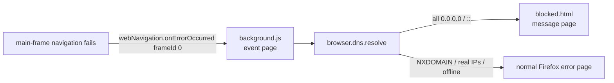

# Agent guide (maintainers & AI assistants)

This document orients anyone (including automated coding agents) who opens this repository so work can continue without rediscovering context.

## Purpose

**Something Fishy** is a personal, **Firefox-only** Manifest V3 Web Extension. When a top-level page fails to load **because the DNS resolver blocked it** (the owner's Pi-hole, which also passes through Cloudflare for Families blocks), it replaces Firefox's generic error page with a message page the owner writes ("encouraging discouragement"), optionally different per site and per time of day, with a local count of attempts.

It is a **message layer, not the lock.** Pi-hole does the blocking; this extension only decorates the failure. It must never react to ordinary failures (typos/NXDOMAIN, sites that are down, being offline), and it must never offer a way past the block.

Human-facing overview: [README.md](README.md).

## Status

**In progress.** Done: pure logic (`src/common/`) with unit tests, dev tooling, icons, and a throwaway [diagnostic extension](tools/diagnostic/) for the owner's PC. **Waiting on:** the owner's diagnostic run (see "Open questions"). Background script, blocked page, options page and signing come after.

## How it decides "blocked by my DNS"

DNS answers carry **no reason code**, so the browser cannot know *who* blocked a name or *which rule* matched. The only signal is the shape of the answer:

| DNS answer | Meaning to us | Action |
|---|---|---|
| Every address is `0.0.0.0` or `::` | Blocked by my DNS (Pi-hole gravity/regex/own rules, or Cloudflare for Families passed through) | Show the message page |
| NXDOMAIN (`dns.resolve` rejects) | Typo / non-existent name | Nothing (normal Firefox error) |
| Any real address | Site down, refused, TLS error, … | Nothing |
| Resolution fails entirely | Offline | Nothing |

Verified on the owner's PC (Windows, DNS pointed only at Pi-hole), 2026-10-21, with `nslookup`:

- `ad.doubleclick.net` (Pi-hole gravity) → `::` and `0.0.0.0`.
- An adult site (Cloudflare for Families block, forwarded by Pi-hole) → `::` and `0.0.0.0`; the same name via `9.9.9.9` → a real address. So both blockers look identical to the browser.
- `thisdomaindoesnotexist-12345.com` → NXDOMAIN.

This depends on Pi-hole staying in its **default blocking mode** (null addresses). In `NXDOMAIN` or `NODATA` blocking modes, blocks are indistinguishable from typos and the extension would correctly stay silent but also never trigger.

`isBlockedAnswer()` in [src/common/address.js](src/common/address.js) also accepts the long spellings of `::` (`0:0:…:0`, `::ffff:0.0.0.0`). An empty address list is **not** treated as blocked.

## Repository map

| Path | Role |
|------|------|
| [src/common/address.js](src/common/address.js) | `SF_ADDRESS.isNullAddress / isBlockedAnswer` — the "is this a block answer" check. |
| [src/common/url.js](src/common/url.js) | `SF_URL.candidateHost(url)` — returns the hostname to DNS-check, or `null` for URLs that must be ignored (non-http(s) schemes incl. `about:`/`moz-extension:`/`file:`, IP literals, `localhost`). |
| [src/common/config.js](src/common/config.js) | `SF_CONFIG.DEFAULT_CONFIG` (shipped placeholder messages) and `normalizeConfig(raw)`, which repairs whatever is in storage. Storage key names. |
| [src/common/rules.js](src/common/rules.js) | `SF_RULES` — hostname pattern matching, first-match rule lookup, time-of-day windows, `pickMessage`, `renderTemplate`. |
| [tests/](tests/) | `node:test` unit tests for everything in `src/common/` (no browser needed). |
| [tools/diagnostic/](tools/diagnostic/) | Throwaway logging-only extension used to verify Firefox's real behaviour on the owner's PC. Not shipped, never redirects. |
| [web-ext-config.cjs](web-ext-config.cjs) | Keeps dev files out of the packaged extension. |
| [icons/](icons/) | Toolbar/store icons. Regenerate with `python3 scripts/generate-icons.py` (`py scripts\generate-icons.py` on Windows) — stdlib-only PNG writer adapted from address-quick-display's. |

## Architecture (runtime, planned)

1. `webNavigation.onErrorOccurred`, filtered to `http`/`https` (Firefox throws on an empty filter), **`frameId === 0` only**. Subframes, images, scripts and ad iframes fail all the time and must never hijack the tab.
2. `SF_URL.candidateHost(url)`; ignore `null`.
3. `dns.resolve(host)`; if `isTRR` is true, record it (DoH got turned back on — Pi-hole is being bypassed; options page warns).
4. If `isBlockedAnswer(addresses)`: increment the local attempt counter, then check the tab still shows that URL (the user may have moved on), then `tabs.update(tabId, { url: blocked.html?url=…, loadReplace: true })`. `loadReplace` replaces the failed history entry so **Back** from the message page doesn't re-trigger the redirect.
5. `blocked.html` reads the config, picks the message with `SF_RULES.pickMessage`, renders it with `textContent` only.

## Settings / storage schema

| Area | Key | Meaning |
|------|-----|---------|
| `storage.local` | `sfConfig` | `{ version: 1, showCount, defaults: { title, messages[] }, rules[] }` — see below. Missing/invalid → `DEFAULT_CONFIG`. |
| `storage.local` | `sfAttempts` | (planned) `{ [hostname]: { count, first, last } }`, ISO timestamps. Local only; resettable from the options page. |

- A **message** is `{ text, from?, to? }`. `from`/`to` are local `HH:MM`; the window is `[from, to)`, wraps past midnight when `from > to`, and `from === to` means all day. A message with only one of the two, or a malformed time, is dropped by `normalizeConfig` (rather than silently becoming all-day).
- A **rule** is `{ pattern, path, enabled, title, messages[] }`. Pattern forms: `example.com` (domain + all subdomains), `=example.com` (exact host), `*.example.com` (subdomains only). `path` is an optional pathname prefix. Non-ASCII patterns are stored as punycode.
- **Selection:** first enabled matching rule wins (options-page order = priority). Within the rule, the first message whose window contains "now"; if none, fall back to the default messages the same way. Title: rule title, else default title.
- **Placeholders:** `{host}`, `{url}`, `{count}`, `{time}`. Unknown ones are left as typed.

## Design decisions (with reasons)

- **Firefox-only, MV3 event page.** `browser.dns` is Firefox-only, so unlike address-quick-display there is no Chromium `service_worker` entry and no `globalThis.browser ?? globalThis.chrome` shim — scripts use `browser` directly. MV3 chosen by the owner to match their other extensions; Firefox keeps MV2 alive, so this is consistency, not necessity.
- **`strict_min_version: "142.0"`** (not 121 as in the owner's other repos): `web-ext lint` requires 140 (desktop) / 142 (Android) for `data_collection_permissions`.
- **webNavigation, not webRequest, in the shipped extension.** Firefox's `webNavigation.onErrorOccurred` does not populate `details.error` (MDN browser-compat-data: `firefox: version_added: false`); only `webRequest.onErrorOccurred` has error strings, and that needs an `<all_urls>` host permission. The decision is made purely from DNS, so the error string isn't needed and the shipped extension keeps **no host permissions**. The diagnostic extension uses webRequest once to learn the strings.
- **React to failures, don't pre-check.** The alternative (blocking `webRequest.onBeforeRequest` + `dns.resolve` on every navigation, MV2 only) adds a lookup to every page load and needs host permissions. Not worth it.
- **No registrable-domain (eTLD+1) matching.** Firefox gives extensions no Public Suffix List API, and bundling the PSL (~250 KB, goes stale) isn't worth it for a personal rule list. The `example.com` = "domain + subdomains" form covers the practical need. Agreed with the owner.
- **Pi-hole REST API lookup ("which list blocked this?"): not now.** Would need a Pi-hole app password stored in the extension and a host permission for a LAN address. Parked in the roadmap.
- **Classic scripts, no build step** (same as the owner's other repos): `src/common/*.js` are IIFEs exposing one `SF_*` global each, so they load as `background.scripts` / `<script>` tags in the browser and via `require()` in Node tests.
- **Dev tooling deviation:** the owner's other repos have no `package.json` or tests. This one adds a dev-only `package.json` (`web-ext` + Node's built-in test runner, no other dependencies) because it needs `web-ext sign`. Nothing from it is packaged.

## How to run & test

- `npm install` once (installs `web-ext` locally; Node ≥ 20).
- `npm test` — unit tests, offline, no browser.
- `npm run lint` — `web-ext lint` on the extension.
- `npm start` — launches a throwaway Firefox profile with the extension loaded. Or `about:debugging#/runtime/this-firefox` → **Load Temporary Add-on…** → `manifest.json`.
- Manual test matrix: see README "Testing".
- **Test from the PC, never from the server:** the server's own DNS doesn't go through Pi-hole.
- **Firefox DNS cache:** after allow/blocklisting in Pi-hole, Firefox may keep the old answer for a while (`about:networking#dns` → **Clear DNS Cache**).

### Debugging

Prefix logs with `[something-fishy]`. Background console: `about:debugging` → the extension → **Inspect**.

## Open questions (verify on the owner's PC before relying on them)

These are **not yet verified** — the diagnostic extension exists to answer them:

1. Does `webNavigation.onErrorOccurred` fire with `frameId: 0` when the name resolves to `0.0.0.0`/`::`? (Expected yes.)
2. What `webRequest` error string does Firefox 158 on Windows report for a connection to `0.0.0.0`/`::`? (Unknown — do **not** assume `NS_ERROR_UNKNOWN_HOST`; Firefox may also refuse `0.0.0.0` before connecting.)
3. Does `dns.resolve` work under MV3, and does it return `["::", "0.0.0.0"]` (or similar) with `isTRR: false`?
4. What does `tabs.get(tabId).url` report while the Firefox error page is shown? (Needed for the "has the user moved on?" check.)
5. Typo domain: does `dns.resolve` reject (expected), and with what message?

## Constraints (do not regress without intent)

- **No bypass.** No "continue anyway", nothing that weakens or routes around the DNS block.
- **Permissions (planned):** `dns, webNavigation, tabs, storage`, **no `host_permissions`**.
- **Privacy:** the only "network" activity is `dns.resolve` through Firefox's normal resolver. No analytics, no remote code, no other requests. Everything stored stays in `storage.local`.
- **No LAN details in the repo:** no IPs, hostnames or IPv6 addresses of the owner's network. The extension doesn't need them.
- **Main frame only;** never act on subframes. Never act on the extension's own pages (no redirect loops).
- **Message text is plain text:** always `textContent`, never `innerHTML`, even though the owner writes it.
- **Don't touch Pi-hole, the server, or DNS settings** from this project.
- **Payload:** no frameworks, no build step; `manifest.json` + `src/` + `icons/` load directly.

## Roadmap

1. Diagnostic run on the owner's PC → resolve the open questions above.
2. Background script, blocked page, options page (rules editor, time windows, attempt counts + reset, DoH warning).
3. Signing as an unlisted add-on via AMO (`npm run sign`), keys from environment variables.
4. Optional, not started: Pi-hole v6 REST API lookup to say *which* list blocked a domain (needs an app password + LAN host permission; weigh with the owner first).
5. Optional, not started: random rotation among several matching messages.

## Shipping

- Bump `version` in `manifest.json`.
- `npm run sign` (unlisted channel). Steps and credential handling: README "Signing".
